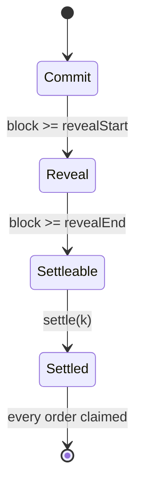
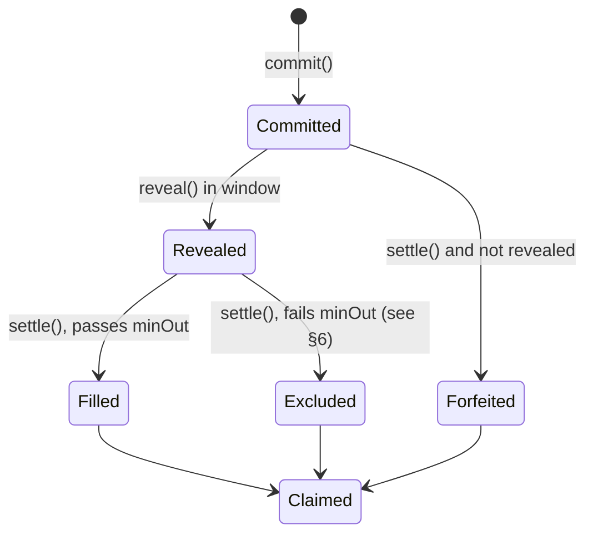

# SPEC.md: BatchRouter (source of truth for behaviour)

**Status:** Phase 1 draft, 2026-10-26. Code must match this file; if they diverge, update one deliberately and log it in `DECISIONS.md`.

**Educational reference only. Not audited.**

## 1. Overview

`BatchRouter` sits in front of one `ConstantProductPair` (`vendor/amm/`) for tokens **A** = `pair.token0()` and **B** = `pair.token1()`. Users submit sealed orders into time-boxed batches. After the reveal window, anyone settles the batch:

1. opposing flow is netted internally;
2. only the net imbalance (the *residual*) is swapped on the AMM;
3. every filled order, on both sides, gets **one uniform price**.

Outputs are pulled with `claim`.

A companion `NaiveRouter` (Phase 2) swaps directly on the pair and is the attack baseline.

## 2. Parameters (immutable, set in constructor)

| Name | Type | Meaning | Validation |
|---|---|---|---|
| `pair` | `ConstantProductPair` | The AMM | non-zero |
| `treasury` | `address` | Sole recipient of forfeited bonds | non-zero |
| `commitBlocks` (C) | `uint64` | Length of a batch's commit window | ≥ 1 |
| `revealBlocks` (R) | `uint64` | Length of the reveal window | ≥ 1 |
| `bond` | `uint256` | ETH (`msg.value`) required per commit | > 0 |
| `genesisBlock` (g) | `uint64` | `block.number` at deploy | — |

Constant: `MAX_ORDERS_PER_BATCH = 100` (re-tuned in Phase 7 from gas data).

## 3. Batch timing and state machine

Batches are back to back and overlap: batch `k+1` commits while batch `k` reveals.

```
batch k:  commit  [g + kC,        g + (k+1)C)
          reveal  [g + (k+1)C,    g + (k+1)C + R)
          settle  block >= g + (k+1)C + R, once
          claim   after settle, once per order
currentBatchId() = (block.number - g) / C
```



The phase is derived from `block.number`; nothing is stored. `settled` is the only stored per-batch state bit.

### Order states



## 4. Data structures

```solidity
enum Status { None, Committed, Revealed, Filled, Excluded, Forfeited }

struct Order {
    address user;        // owner; set at commit to msg.sender
    bool aToB;           // direction: true = sells A for B
    bool claimed;
    Status status;
    bytes32 commitHash;
    uint128 escrow;      // tokenIn escrowed at commit (may exceed amountIn, to hide size)
    uint128 amountIn;    // set at reveal, <= escrow
    uint128 minOut;      // set at reveal
}

struct Batch {
    uint32 orderCount;
    bool settled;
    uint128 filledInA;   // XA: total amountIn of filled A->B orders
    uint128 filledInB;   // XB: total amountIn of filled B->A orders
    uint128 potB;        // B available to A->B sellers after settlement
    uint128 potA;        // A available to B->A sellers after settlement
}
mapping(uint256 batchId => Batch) batches;
mapping(uint256 batchId => mapping(uint256 index => Order)) orders;
uint256 forfeitedBonds;  // ETH owed to treasury
```

Amounts are capped at `uint128`; the AMM caps reserves at `uint112`. All products in §5 use OpenZeppelin `Math.mulDiv`, so intermediates cannot overflow.

## 5. Commitment

```
commitHash = keccak256(abi.encode(
    block.chainid, address(router),            // domain separation (D-005)
    tokenIn, tokenOut, amountIn, minOut, salt, user))
```

- `user` is bound, so a copied commit cannot be revealed as someone else's.
- `salt` (32 random bytes, kept secret off-chain) prevents brute-forcing `minOut` and `amountIn`.
- `abi.encode` (not `encodePacked`) is used, so there is no ambiguity in the encoding.
- A view helper `computeCommitHash(...)` is provided for clients and tests.

## 6. Functions

### `commit(bytes32 commitHash, address tokenIn, uint256 escrow) payable returns (uint256 batchId, uint256 index)`

Reverts with:
- `WrongBond` if `msg.value != bond`;
- `InvalidToken` if `tokenIn ∉ {A, B}`;
- `ZeroAmount` if `escrow == 0`;
- `AmountTooLarge` if `escrow > type(uint128).max`;
- `BatchFull` if the current batch has `MAX_ORDERS_PER_BATCH` orders.

Effects:
- The order goes into batch `currentBatchId()` at `index = orderCount++`, with status `Committed`.
- `safeTransferFrom(user, router, escrow)` runs. The router then checks that its balance increased by exactly `escrow`; otherwise it reverts with `UnsupportedToken` (fee-on-transfer and rebasing tokens are rejected).

Emits: `Committed(batchId, index, user, tokenIn, escrow, commitHash)`.

### `reveal(uint256 batchId, uint256 index, uint256 amountIn, uint256 minOut, bytes32 salt)`

- **Callable by anyone** (D-006). The hash binds `user`, so all funds still go to `order.user`.

Reverts with:
- `NotInRevealWindow` if the block is outside batch `batchId`'s reveal window;
- `BadStatus` if the order is not `Committed` (this covers double-reveal and an unknown index);
- `HashMismatch` if the recomputed hash ≠ `commitHash`;
- `ZeroAmount` if `amountIn == 0`;
- `ExceedsEscrow` if `amountIn > escrow`.

Effects: stores `amountIn` and `minOut`; the status becomes `Revealed`.

Emits: `Revealed(batchId, index, amountIn, minOut)`.

### `settle(uint256 batchId)`

- **Permissionless.** It is callable once, at a block ≥ the batch's `revealEnd`.

Reverts with:
- `NotSettleable` if called too early;
- `AlreadySettled` if called a second time.

Algorithm:
1. **Forfeit.** Every order still `Committed` becomes `Forfeited`, and `forfeitedBonds += bond`.
2. **Include.** The included set is every `Revealed` order.
3. **Loop** (at most `orderCount` rounds):
   1. Compute `XA`, `XB`, the residual and the pots from the AMM reserves (§7).
   2. For each included order, compute `out_i = floor(amountIn_i · pot / X_side)`.
   3. If every order satisfies `out_i ≥ minOut_i`, stop.
   4. Otherwise, **for each side separately**, exclude *all* violating orders whose limit ratio `minOut_i / amountIn_i` equals that side's maximum among violators. Ties go out together, so the rule depends only on the set of orders, never on index or position. Compare ratios by cross-multiplying, never by dividing.
   5. Excluded orders get status `Excluded`; go back to step 3.1.
4. **Execute.** If the residual > 0, call `pair.swapExactIn(residualToken, residual, quotedOut, router)`. `quotedOut` is the exact output computed in step 3.1 for the same block and reserves, so the swap returns exactly that amount or reverts.
5. **Record.** Store `filledInA`, `filledInB`, `potA` and `potB`; mark the included orders `Filled` and set `settled = true`.

Emits:
- `OrderExcluded(batchId, index)` for each excluded order;
- `Settled(batchId, filledInA, filledInB, residualToken, residualIn, residualOut, potA, potB)`.

### `claim(uint256 batchId, uint256 index)`

- Only `order.user` may call it (D-006), and only after settle and only once (`claimed` flag).
- Uses checks-effects-interactions: set `claimed = true` first, then transfer.
- Protected with `nonReentrant`.

| Status | tokenOut paid | tokenIn refunded | Bond returned |
|---|---|---|---|
| Filled | `floor(amountIn · pot_side / X_side)` | `escrow − amountIn` | yes |
| Excluded | 0 | `escrow` | yes |
| Forfeited | 0 | `escrow` | **no** (it went to `forfeitedBonds`) |

Emits: `Claimed(batchId, index, user, amountOut, refund, bondReturned)`.

### `withdrawForfeits()`

- Anyone may trigger it. It sends `forfeitedBonds` to `treasury`, which is the only possible recipient, and resets the counter first.

Emits: `ForfeitsWithdrawn(treasury, amount)`.

### Views

`currentBatchId()`, `batchWindows(batchId)`, `getOrder(batchId, index)`, `getBatch(batchId)`, `computeCommitHash(...)`, `previewOut(batchId, index)`.

## 7. Clearing-price math

Notation:
- `a`, `b`: the AMM reserves of A and B, read at settle.
- `γ = 997/1000`.
- `XA`: total revealed and included A in, from A→B sellers.
- `XB`: total B in, from B→A sellers.
- `P`: the uniform price in B per A.

There are two conservation constraints. If `r` units of A go to the AMM and return `out(r)` B:

```
A:  XA = r + (A paid to B-sellers)      =>  A to B-sellers = XA - r = XB / P
B:  XB + out(r) = (B paid to A-sellers) =>  P = (XB + out(r)) / XA
```

Both must hold at the same P, so `out(r) / r = XB / (XA − r)`. Substituting the V2 formula `out(r) = r·997·b / (1000·a + 997·r)`:

```
997·b·(XA − r) = XB·(1000·a + 997·r)
r_A = (997·b·XA − 1000·a·XB) / (997·(b + XB))        (A is in excess when this is > 0)
```

The symmetric case, with B in excess, is `r_B = (997·a·XB − 1000·b·XA) / (997·(a + XA))`.

**Interpretation.** P equals the AMM's *average* execution price on the residual. The matched part therefore trades at exactly the price the marginal flow paid. That is what makes the price uniform: there is no separate "spot for the matched part, impact for the rest".

There are three cases:

| Case | Condition | Residual | Pots |
|---|---|---|---|
| A excess | `997·b·XA > 1000·a·XB` | `r_A` of A to the AMM | `potB = XB + out(r_A)`, `potA = XA − r_A` |
| B excess | `997·a·XB > 1000·b·XA` | `r_B` of B to the AMM | `potA = XA + out(r_B)`, `potB = XB − r_B` |
| Fee band | neither | none | `potB = XB`, `potA = XA` (so P = XB/XA, which lies within the 0.3% fee band around spot) |

- A one-sided batch (`XB = 0`) gives `r_A = XA`: the batch reduces to one AMM swap of the total.
- The cases are mutually exclusive, because `997/1000 < 1000/997`.

**Payouts.**
- An A→B seller gets `floor(amountIn_i · potB / XA)`.
- A B→A seller gets `floor(amountIn_i · potA / XB)`.

**Conservation by construction.** Payouts are pro-rata shares of pots that physically exist, rounded down, so Σ payouts ≤ pot on each side. Rounding the residual `r` (down, via `mulDiv`) only perturbs P between sides by at most rounding; it can never create value.

**Dust.** The total dust is less than the number of filled orders on that side, in base units. It stays in the router and is accounted for (Phase 6 invariant: router balance after all claims equals the tracked dust plus unclaimed amounts).

Reference values, verified with an exact-integer script (D-007). The pool is 1,000 ETH / 2,000,000 USDC, and P is in USDC per ETH:

| XA (ETH) | XB (USDC) | Case | P for A-sellers | P for B-sellers |
|---|---|---|---|---|
| 10 | 30,000 | B excess, r = 9,841.405404 USDC | 2015.859460 | 2015.859460 |
| 30 | 10,000 | A excess, r = 24.8607 ETH | 1945.771961 | 1945.771961 |
| 10 | 20,000 | fee band | 2000.000000 | 2000.000000 |
| 10 | 20,050 | fee band | 2005.000000 | 2005.000000 |
| 0 | 100,000 | one-sided | — | 2106.018054 (= direct swap, 47.482973758155927037 ETH) |

Phase 4 unit tests must reproduce these numbers.

## 8. Events and errors

**Events:**
- `Committed(batchId, index, user, tokenIn, escrow, commitHash)`
- `Revealed(batchId, index, amountIn, minOut)`
- `OrderExcluded(batchId, index)`
- `Settled(batchId, filledInA, filledInB, residualToken, residualIn, residualOut, potA, potB)`
- `Claimed(batchId, index, user, amountOut, refund, bondReturned)`
- `ForfeitsWithdrawn(treasury, amount)`

**Errors:** `WrongBond`, `InvalidToken`, `ZeroAmount`, `AmountTooLarge`, `BatchFull`, `UnsupportedToken`, `NotInRevealWindow`, `BadStatus`, `HashMismatch`, `ExceedsEscrow`, `NotSettleable`, `AlreadySettled`, `NotOrderOwner`, `NotSettled`, `AlreadyClaimed`, `ZeroAddress`, `InvalidWindow`, `EthTransferFailed`.

## 9. Failure cases

| Case | Behaviour |
|---|---|
| User never reveals | Forfeited at settle: bond to the treasury, escrow refundable via `claim` |
| Order fails `minOut` at P | Excluded by the §6 loop; full escrow and bond returned |
| Every order excluded | No AMM swap; the batch settles empty |
| No orders | `settle` just marks the batch settled |
| `settle` never called | Anyone (including any user) can call it at any later block. **Open item (Phase 7):** a timeout path if settle permanently reverts |
| AMM swap reverts in settle | The whole settle reverts. Funds are not lost, and settle can be retried later. Same Phase 7 open item |
| ETH bond refund to a contract that rejects ETH | `claim` reverts for that user only (`EthTransferFailed`); no one else is affected |
| Fee-on-transfer / rebasing token | Rejected at commit (balance-delta check) |

## 10. Trust assumptions and roles

- **No owner, no admin, no pause.** All parameters are immutable.
- **`treasury`** is fixed at deploy and is the only address that receives forfeited bonds.
- **The settler is anyone.** They choose *when* to settle within the allowed range, which gives timing influence over the AMM state (see `THREAT_MODEL.md`). Per-order `minOut` bounds the harm.
- **The AMM** is trusted to be the vendored `ConstantProductPair`.
- **Tokens** are assumed to be standard ERC-20s; fee-on-transfer tokens are rejected at commit.

## 11. Baseline: `NaiveRouter` (Phase 2)

This is the attack baseline, not part of the batch design. It behaves like a Uniswap V2 router restricted to one pair.

| Item | Behaviour |
|---|---|
| Constructor | `NaiveRouter(ConstantProductPair pair)`; reverts `ZeroAddress` for a zero pair |
| `swapExactIn(tokenIn, amountIn, minOut, to, deadline) → amountOut` | `nonReentrant`. Reverts `Expired` if `block.timestamp > deadline` and `ZeroAddress` if `to == 0`. A foreign token reverts in the pair (`InvalidToken`) before any transfer. It pulls `amountIn`, measures the balance increase, approves exactly that amount to the pair and calls `pair.swapExactIn(tokenIn, received, minOut, to)`. The pair enforces `minOut` (`InsufficientOutput`) |
| Event | `Swapped(user, tokenIn, amountIn, amountOut, to)` |
| Holdings | The router holds no tokens and leaves no allowance after a call (tested) |
| Protection | Only `minOut`. A sandwich pushes the victim to exactly `minOut` (Phase 2 results in `LEARN.md` 2.6 and `README.md` §4) |
